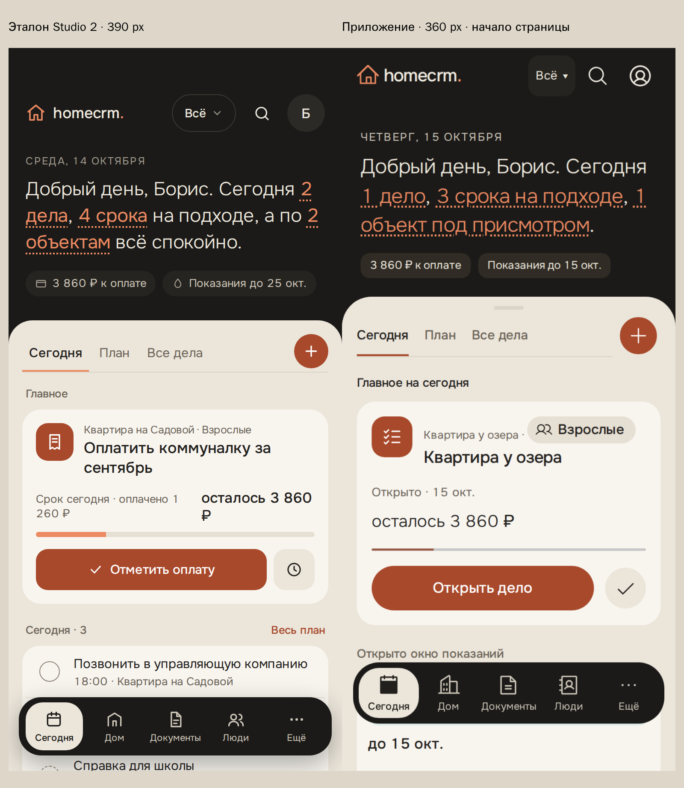
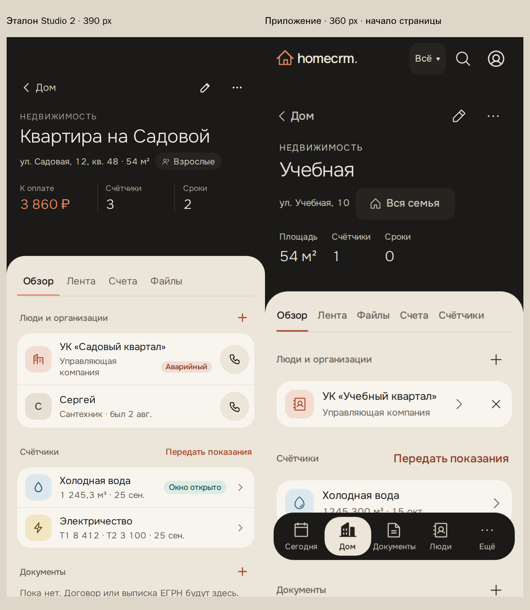
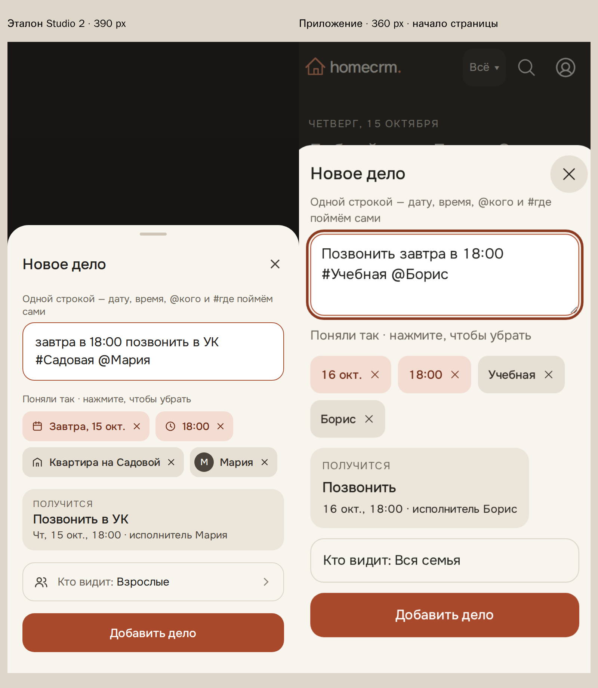

# Studio 2 · UI-4

Linux, Playwright 1.63.0, настоящие API и одноразовая база с вымышленной семьёй. В эталоне — утверждённая разметка `docs/design/studio2/` без `support.js` и внешних шрифтов. В приложении — данные сценариев, поэтому подписи и длина страниц различаются.

Окружение: `apps/web/e2e/studio2/compose.yaml`, проект `homecrm-test-ui-4-studio2`. Для полного `pnpm check` на Windows адрес его случайного локального порта передаётся через `HOMECRM_TEST_PG_ADMIN_URL`; `max_locks_per_transaction=1024` оставляет место для параллельных миграций одноразовых баз.

| Сегодня | Объект | Быстрое добавление |
|---|---|---|
|  |  |  |

Полные снимки: `w360-*` и `w412-*`; `text200` и `empty-200` — увеличение текста 200%, `error` — ошибка одного показателя, `zero` — настоящие нули, `child` — ребёнок, `quick-three-chips` — снято время. Нормальный лист быстрого добавления снят в пределах окна; его кнопка сохранения видна без прокрутки.

Сумма метки относится к активным оплатам выбранного радара в группах «Просрочено», «Сейчас», «7 дней». Готового агрегата общей задолженности объекта и даты последнего визита контакта в карточке нет: эти факты не выдумываются. Шапка объекта показывает площадь, активные счётчики и собственные сроки из доступных ответов.

Исправление скачка карточки: `w360-object-spacing-100.png`, `w360-object-spacing-200.png`, `w412-object-spacing-100.png`, `w412-object-spacing-200.png` — раскрытые факты и поля после ответа API дел. Большая плашка загрузки раньше заменялась строкой другой высоты: между двумя замерами получалось −9,203125 px даже при загруженном Onest; одновременный отступ оставался 24,84 px. Теперь загрузка и пустой ответ используют одинаковую компактную строку. Новый сценарий задерживает ответ ровно между замерами, проверяет запасной шрифт, смену на Onest, 100/200%, axe и цели 44 px; исходный `files-ui.e2e.ts` не менялся.
