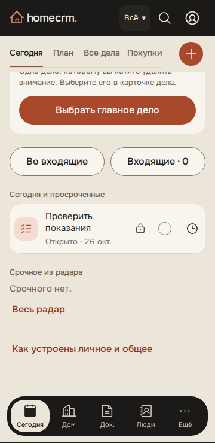
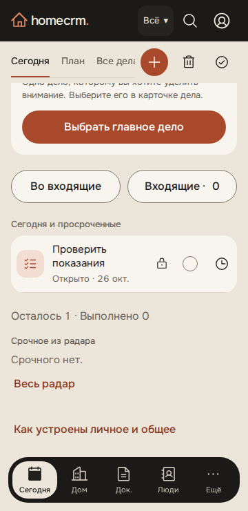
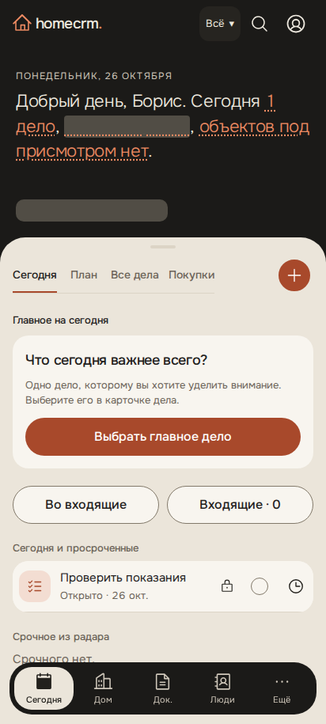
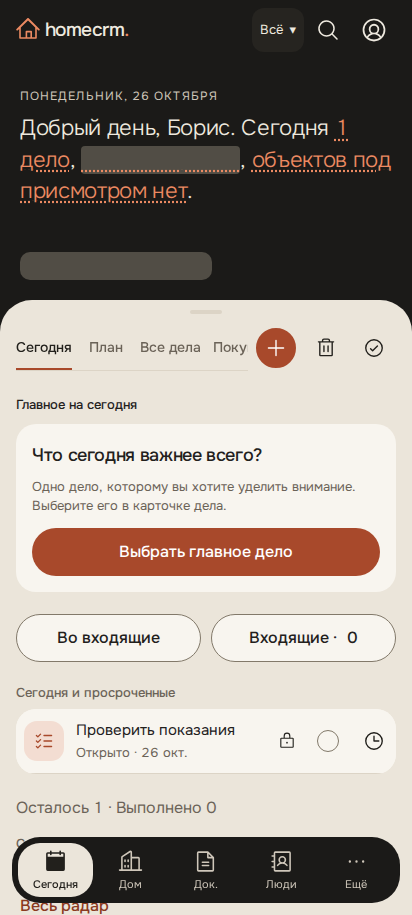

# D30: материалы проверки

Linux Playwright, вымышленная семья, 360×740 и 412×915 px. Снимки — с `animations: 'disabled'`; записи — с обычным движением. «До» — исходники `d4d4c42`, «после» — этот PR.

| Ширина | До | После |
|---|---|---|
| 360 px |  |  |
| 412 px |  |  |

Записи вперёд/назад на 360 px: [до](before-360.webm), [после](after-360.webm). Генератор — `e2e/app/motion-recording.e2e.ts`, исходники «до» смонтированы из `git archive` без правок рабочей копии.

Системный «Назад» оставлен мгновенным. Chromium проверяет back/forward и сохраняет диагностический JSON в `test-results/screens/D30/history-*.json`; Navigation API не перехватывается. Попытка WebKit в Linux остановилась на входе в приложение, до проверки жеста, поэтому Safari iOS не считается проверенным. Окончательная проверка Chrome Android и Safari iOS — на настоящих устройствах владельца после выпуска.
